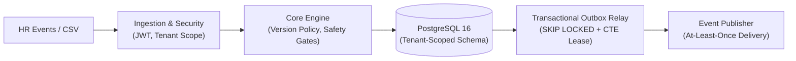

# RosterGuard — Reliable Employee Roster Synchronisation Service

> **MoveInSync SDE Intern Case Study Implementation**  
> A multi-tenant employee roster synchronisation service built with **Java 21**, **Spring Boot 3.4.5**, and **PostgreSQL 16**. Bridges asynchronous real-time HR event streams and nightly full-roster CSV reconciliation with version-aware conflict handling, transactional side effects, and guarded deactivations.

---

## 1. Project Overview

RosterGuard maintains synchronized employee records across corporate HR systems and fleet transportation platforms. It addresses out-of-order events, duplicate deliveries, split-brain payload conflicts, and corrupted nightly CSV snapshots. The service enforces strict tenant boundaries, atomic version monotonicity, and transactional outbox guarantees without relying on distributed locks.

---

## 2. Quickstart & Reproducible Demo

### Prerequisites
- Docker & Docker Compose
- `curl` (and optionally `jq`)

### Run Application
```bash
# 1. Launch PostgreSQL and RosterGuard containers
docker compose up --build -d

# 2. Verify service health
curl -s http://localhost:8080/actuator/health
```

The service starts PostgreSQL on port `5432` and RosterGuard on `8080` under the `dev` profile with pre-seeded demo tenants (`tenant-1`, `tenant-2`).

For complete end-to-end evaluation (token minting, HR event ingestion, CSV import, and outbox relay verification), follow the step-by-step **[Evaluator Demo Runbook](docs/DEMO_RUNBOOK.md)** or use the pre-configured **[Postman Collection](postman/RosterGuard.postman_collection.json)**.

---

## 3. System Architecture



See **[docs/DESIGN.md](docs/DESIGN.md)** for detailed data flows, schema design, and architectural decisions.

---

## 4. Core Engineering Guarantees

1. **Version Monotonicity & Conflict Handling:** Real-time events and CSV rows share an authoritative `source_version`. Updates execute via atomic conditional SQL (`WHERE employee.source_version < EXCLUDED.source_version`). Same-version conflicts with differing payloads are quarantined in `employee_event_review` for operator triage.
2. **Guarded CSV Reconciliation & $O(1)$ Memory:** Streams CSV snapshots row-by-row into PostgreSQL staging tables in batches of 1,000, keeping JVM heap flat. Five safety gates halt execution if headers are invalid, employee IDs are missing or duplicated, snapshots are stale, or the absent-employee ratio exceeds the threshold (default 30%).
3. **Physical Multi-Tenant Isolation:** Every table primary key and foreign key starts with `tenant_id`, derived strictly from validated JWT claims.
4. **Transactional Outbox & Side Effects:** Mutations (`CREATED`, `UPDATED`, `DEACTIVATED`, `TRANSPORT_UPDATED`) transactionally insert outbox events. Employee deactivation atomically cancels future bookings and releases seats in the same transaction. The relay guarantees at-least-once delivery using `SKIP LOCKED` and atomic lease renewal.

---

## 5. REST API Overview

All tenant endpoints enforce stateless JWT authentication with claims `tenant` and `roles`. See **[docs/API_REFERENCE.md](docs/API_REFERENCE.md)** for full request/response schemas, DTOs, and error codes.

| Method | Endpoint | Allowed Roles | Description |
|---|---|---|---|
| `POST` | `/api/dev/token` | *Public* *(profile `dev` only)* | Mint development JWT with specified tenant & roles |
| `POST` | `/api/v1/employees/events` | `HR_INTEGRATION` | Ingest real-time HR events batch |
| `GET` | `/api/v1/employees/{id}` | `EMPLOYEE` *(self)*, `TRANSPORT_ADMIN`, `OPERATOR` | Retrieve employee profile |
| `GET` | `/api/v1/employees` | `TRANSPORT_ADMIN`, `OPERATOR` | Keyset-paginated tenant employee directory |
| `PUT` | `/api/v1/employees/{id}/transport` | `TRANSPORT_ADMIN` | Update pickup point & assistance (emits outbox event) |
| `POST` | `/api/v1/roster-imports` | `HR_INTEGRATION` | Stream nightly CSV roster snapshot |
| `GET` | `/api/v1/roster-imports/{id}` | `OPERATOR` | Import status & reconciliation counters |
| `GET` | `/api/v1/roster-imports/{id}/errors` | `OPERATOR` | Keyset-paginated row error reports |
| `POST` | `/api/v1/roster-imports/{id}/approve` | `OPERATOR` | Atomically approve held import and run deactivations |
| `POST` | `/api/v1/roster-imports/{id}/reject` | `OPERATOR` | Reject held import |
| `GET` | `/api/v1/ops/outbox` | `OPERATOR` | Keyset-paginated outbox event monitoring |
| `GET` | `/api/v1/ops/outbox/{id}` | `OPERATOR` | Single outbox event details |
| `GET` | `/actuator/health` | *Public* | Liveness and readiness health probe |

---

## 6. Empirically Verified Benchmarks

Measured on Windows 11 AMD64 (32 cores), JDK 21, and PostgreSQL 16 via Testcontainers. Run test suite: `mvn -B -ntp clean test` (189 tests, 0 failures).

- **200,000-Row CSV Ingestion (`CsvReconciliationBenchmark`):** Completed in **29.07s** (6,879 rows/sec) with **113 MB peak heap** against a 256 MB threshold.  
  *Workload disclosure:* This benchmark measures an initial bulk population of all-new employee records; it is not a mixed existing/changed/missing reconciliation workload.
- **Event Ingestion Throughput (`EventIngestionBenchmark`):** Reached **2,195 ops/sec** at 16 threads (p50: 5.23ms, p99: 33.16ms).
- **Concurrency Stress (`ConcurrencyStressTest`):** 1,000 version updates across 4 threads + 2 outbox relay workers + concurrent CSV import completed in **10.19s** with 0 deadlocks and strict monotonicity.

---

## 7. Failure Handling

RosterGuard anticipates operational failure modes across network partitions, malformed inputs, and concurrent mutations. Detailed recovery flows and automated test proofs for all 14 scenarios are documented in **[docs/FAILURE_MODES.md](docs/FAILURE_MODES.md)**:

- **Out-of-Order & Duplicate Events (F1, F2):** Discarded via conditional upsert and canonical SHA-256 payload hashing without state corruption.
- **Same-Version Discrepancies (F3):** Quarantined in `employee_event_review` for operator resolution.
- **Corrupted / Truncated CSV Files (F4–F7, F12):** Tripped safety gates halt execution in `NEEDS_REVIEW` or `AWAITING_APPROVAL` before deactivations occur.
- **Partial Mutation Failures (F8):** Database transactions roll back employee updates, booking cancellations, seat releases, and outbox rows atomically.
- **Relay Worker Crashes & Broker Outages (F9, F10):** Expired leases trigger automatic reclamation; repeated failures transition to dead-letter queue (`FAILED`) with exponential backoff.

---

## 8. Documentation & Evaluation Assets

- 📖 **System Design & Architecture:** [docs/DESIGN.md](docs/DESIGN.md)
- 📋 **Complete API Reference:** [docs/API_REFERENCE.md](docs/API_REFERENCE.md)
- 🛡️ **Failure Modes & Mitigation Matrix:** [docs/FAILURE_MODES.md](docs/FAILURE_MODES.md)
- 🚀 **Evaluator Demo Runbook:** [docs/DEMO_RUNBOOK.md](docs/DEMO_RUNBOOK.md)
- 📮 **Postman Collection:** [postman/RosterGuard.postman_collection.json](postman/RosterGuard.postman_collection.json)
- 📁 **Sample Happy-Path Roster:** [samples/happy_path_roster.csv](samples/happy_path_roster.csv)
- 📁 **Sample Duplicate-ID Roster:** [samples/duplicate_id_roster.csv](samples/duplicate_id_roster.csv)
