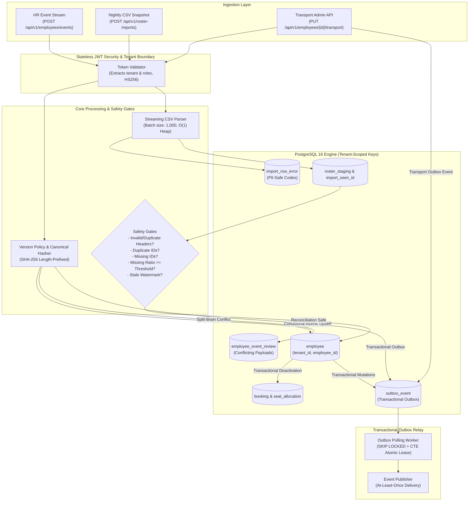

# RosterGuard — Reliable Employee Roster Synchronisation Service

> **MoveInSync SDE Intern Case Study Implementation**  
> An enterprise-grade, multi-tenant employee roster synchronisation service built with **Java 21**, **Spring Boot 3.4.5**, and **PostgreSQL 16**.  
> Bridges asynchronous real-time HR event streams and nightly full-roster CSV reconciliation without race conditions, data loss, or unsafe deactivations.

---

## Documentation & Evaluation Assets

- 📖 **[System Design & Architecture](docs/DESIGN.md):** Architectural flows, state machine, and data models.
- 📋 **[Complete API Reference](docs/API_REFERENCE.md):** Detailed endpoint specifications, request/response DTOs, and JWT role requirements.
- 🛡️ **[Failure Modes & Self-Healing Matrix](docs/FAILURE_MODES.md):** 14 operational scenarios, detection mechanisms, and automated test proofs.
- 🚀 **[Evaluator Demo Runbook](docs/DEMO_RUNBOOK.md):** Step-by-step copy-paste guide to exercise all features end-to-end.
- 📮 **[Postman Collection](postman/RosterGuard.postman_collection.json):** Pre-configured, self-contained Postman collection with automatic token chaining.
- 📁 **Sample Fixtures:** [Happy Path Roster](samples/happy_path_roster.csv) • [Duplicate ID Roster](samples/duplicate_id_roster.csv)

## 1. System Architecture



---

## 2. Core Architectural Principles & Invariants

1. **Unified Version Monotonicity Without Locks (D1/D1b):**
   - All real-time API events and CSV rows share a single monotonically increasing integer `sourceVersion` and timestamp `sourceUpdatedAt` provided by the authoritative HR system.
   - State updates execute via a single conditional atomic SQL statement:
     ```sql
     INSERT INTO employee (tenant_id, employee_id, ..., source_version)
     VALUES (?, ?, ..., ?)
     ON CONFLICT (tenant_id, employee_id) DO UPDATE SET
         name = EXCLUDED.name,
         source_version = EXCLUDED.source_version,
         ...
     WHERE employee.source_version < EXCLUDED.source_version;
     ```
   - Concurrent updates serialize at the row level without explicit table locks or distributed locks.
2. **Defensive CSV Reconciliation & $O(1)$ Memory (D3, D15, D16):**
   - CSV processing streams row-by-row into PostgreSQL unlogged staging tables in batches of 1,000. JVM heap utilization remains flat ($O(1)$) regardless of file size.
   - **Header Validation & Column Reordering:** The CSV header is strictly validated for required columns (`employeeId`, `sourceVersion`, `sourceUpdatedAt`, `name`, `email`, `phone`, `managerId`, `officeCode`, `shiftCode`), duplicates, and unexpected columns. Arbitrary column ordering in valid files is handled cleanly via dynamic column mapping.
   - **Upload Limits:** Configured with 32MB max file size and 34MB max multipart request size to protect memory and bandwidth.
   - **Seen ID Tracking:** Every parseable employee ID is recorded in `import_seen_id` before field validation. A syntax error in a profile does not mark an employee as missing.
   - **Safety Gates & Configurable Threshold:** If duplicate employee IDs exist, any row has a missing ID, or absent employees exceed the configurable safety threshold (`rosterguard.roster.missing-threshold`, default 30%, validated 0.0–1.0), reconciliation halts in `NEEDS_REVIEW` or `AWAITING_APPROVAL`. Zero deactivations occur without manual human sign-off.
   - **Stale Snapshot Watermark Protection:** A tenant-level watermark (`tenant.latest_snapshot_watermark`) tracks the latest applied snapshot timestamp. Any snapshot with `snapshotGeneratedAt <= latest_snapshot_watermark` is halted as `NEEDS_REVIEW` (`HoldReason.STALE_SNAPSHOT`), preventing an older snapshot from overwriting newer state.
   - **Atomic Approval / Rejection:** Status transitions from `AWAITING_APPROVAL` to `COMPLETED` or `REJECTED` are executed atomically with conditional row checks (`WHERE status = 'AWAITING_APPROVAL'`), eliminating approval/rejection races.
3. **Physical Multi-Tenant Isolation (D10):**
   - Every database table begins with `tenant_id` as the primary key prefix.
   - Foreign keys to `employee`, `roster_import`, and `booking` are composite keys including `tenant_id`, enforced physically by the PostgreSQL engine.
   - Tenant context is extracted exclusively from the authenticated JWT `tenant` claim, never from request parameters.
4. **Comprehensive Transactional Outbox for All Applied Mutations (D12, D14):**
   - Every state change enqueues an outbox event in the same transaction:
     - `EMPLOYEE_CREATED` on HR API and CSV employee creation
     - `EMPLOYEE_UPDATED` on HR API and CSV profile updates
     - `EMPLOYEE_DEACTIVATED` on HR event and CSV deactivation
     - `EMPLOYEE_TRANSPORT_UPDATED` on Transport Admin edits (updating pickup location or wheelchair assistance)
   - **Transport Outbox Event Decision:** Downstream vehicle routing, shift rostering, and driver dispatch engines must be notified immediately when an employee's pickup point or special assistance needs change, even though transport edits do not modify the HR source version.
   - **Set-Based Writable CTEs:** For bulk CSV imports, employee upserts, deactivations, booking cancellations, seat releases, and outbox insertions execute simultaneously in single writable CTE queries directly inside PostgreSQL, maintaining $O(1)$ memory.
   - **Relay Mechanism:** The outbox relay uses `SELECT ... FOR UPDATE SKIP LOCKED` combined with an atomic CTE lease renewal (`next_attempt_at = now() + interval '60s'`) to prevent concurrent workers from claiming the same event.
   - Guarantees **at least once** delivery. Downstream consumers deduplicate using `id` or `dedup_key`.

---

## 3. REST API Overview

All tenant endpoints enforce stateless JWT authentication with claims `tenant` and `roles`. Tenant scoping is derived strictly from the cryptographically verified token claim.

| Method | Endpoint | Allowed Roles | Description |
|---|---|---|---|
| `POST` | `/api/dev/token` | *Unauthenticated* *(profile `dev` only)* | Mint test JWT with custom tenant & roles |
| `POST` | `/api/v1/employees/events` | `HR_INTEGRATION` | Ingest real-time HR event (CREATE, UPDATE, DEACTIVATE) |
| `GET` | `/api/v1/employees/{id}` | `EMPLOYEE` *(self)*, `TRANSPORT_ADMIN`, `OPERATOR` | Read employee profile |
| `GET` | `/api/v1/employees` | `TRANSPORT_ADMIN`, `OPERATOR` | Keyset-paginated directory of tenant employees |
| `PUT` | `/api/v1/employees/{id}/transport` | `TRANSPORT_ADMIN` | Update pickup point & assistance (emits outbox event) |
| `POST` | `/api/v1/roster-imports` | `HR_INTEGRATION` | Stream nightly CSV snapshot (max 32MB file / 34MB req) |
| `GET` | `/api/v1/roster-imports/{id}` | `OPERATOR` | Inspect import reconciliation status & counters |
| `GET` | `/api/v1/roster-imports/{id}/errors`| `OPERATOR` | Paginated PII-safe row-level syntax errors |
| `POST` | `/api/v1/roster-imports/{id}/approve`| `OPERATOR` | Approve held import (atomic deactivation & watermark) |
| `POST` | `/api/v1/roster-imports/{id}/reject` | `OPERATOR` | Reject held import |
| `GET` | `/api/v1/ops/outbox` | `OPERATOR` | Monitor outbox events with composite keyset pagination |
| `GET` | `/api/v1/ops/outbox/{id}` | `OPERATOR` | Fetch single outbox event details |
| `GET` | `/actuator/health` | *Public* | Liveness and readiness health probe |

---

## 4. Empirically Verified Benchmarks (Milestone 6)

All benchmarks were measured on Windows 11 AMD64 (32 logical cores) using JDK 21.0.13 and PostgreSQL 16 via Testcontainers.

### Benchmark 1: 200,000-Row CSV Reconciliation (`CsvReconciliationBenchmark`)
Target: Completion within 60 seconds and capped heap memory $\le 256$ MB.
```
================================================================================
BENCHMARK 1 RESULTS:
  Total Rows:           200,000 (~18 MB synthetic CSV)
  Total Time:           29.07 seconds (29,074 ms)
  Throughput:           6,879 rows/second
  Baseline Heap:        31 MB
  Peak Heap:            113 MB (Cap: 256 MB)
  Evaluation:           PASS (Time: 29.07s <= 60s | Peak Heap: 113 MB <= 256 MB)
================================================================================
```

### Benchmark 2: Event Ingestion Throughput & Latency (`EventIngestionBenchmark`)
Measured over 1,000 real-time events across worker concurrency levels:
| Concurrency | Throughput | Latency p50 | Latency p90 | Latency p95 | Latency p99 |
|---|---|---|---|---|---|
| **1 thread** | 264 ops/sec | 1.86 ms | 6.60 ms | 13.57 ms | 30.08 ms |
| **4 threads** | 708 ops/sec | 4.16 ms | 9.38 ms | 14.47 ms | 21.58 ms |
| **8 threads** | 1,959 ops/sec | 3.41 ms | 5.92 ms | 7.16 ms | 11.74 ms |
| **16 threads** | 2,195 ops/sec | 5.23 ms | 12.64 ms | 16.15 ms | 33.16 ms |

### Benchmark 3: Concurrency Stress Test (`ConcurrencyStressTest`)
- **Workload:** 4 threads executing 20 sequential version updates across 50 employees (1,000 updates) + 2 outbox relay workers continuously claiming and publishing + 1 concurrent CSV import (2,000 rows).
- **Result:** Completed in **10.19 seconds**. 0 deadlocks, strict version monotonicity preserved, exactly 0 duplicate publications.

### Benchmark 4: Malformed CSV & Resilience Test (`LargeFileResilienceTest`)
- **20,000 rows with 10% malformed lines:** Processed in 15.05 seconds with 0 MB heap delta ($O(1)$ streaming). All syntax errors and unknown office codes captured in `import_row_error` with zero raw PII logged.
- **Duplicate ID detection:** 1,000 rows with duplicate employee IDs immediately held in `NEEDS_REVIEW`; 0 destructive updates applied.

---

## 5. Failure Modes & Mitigation Matrix

| Failure Mode | Trigger / Scenario | RosterGuard Mitigation | Automated Test |
|---|---|---|---|
| **F1: Out-of-Order Events** | Older event (v2) arrives after newer (v3) | Atomic conditional SQL ignores stale update (`409 STALE`). | `EmployeeConcurrencyIT` |
| **F2: Duplicate Deliveries** | HR system resends same payload | SHA-256 payload hash match returns `200 DUPLICATE` (no-op). | `EmployeeSyncServiceIT` |
| **F3: Same-Version Conflict** | Identical version with different payload | Routed to `employee_event_review` for operator decision. | `EmployeeSyncServiceIT` |
| **F4: Truncated CSV File** | 50% of employees missing from CSV | Missing ratio $\ge$ configured threshold (30%) triggers `AWAITING_APPROVAL`. | `RosterImportSafetyGatesIT` |
| **F5: Malformed CSV Rows** | Syntax error in profile row | Field error logged without PII; employee ID recorded in seen list. | `LargeFileResilienceTest` |
| **F6: Duplicate IDs in Snapshot**| Same ID appears twice in CSV | Detector halts reconciliation; status set to `NEEDS_REVIEW`. | `LargeFileResilienceTest` |
| **F7: Stale CSV Snapshot** | Old snapshot uploaded after newer events | Tenant watermark check and source condition `source_updated_at <= snapshot_at` protects newer data. | `RosterImportSafetyGatesIT` |
| **F8: Partial Deactivation Crash**| DB error or outbox failure during mutation | Wrapped in single `@Transactional`; all side-effects and employee changes roll back. | `OutboxMutationsIT` |
| **F9: Worker Crash on Publish** | Relay crashes after sending message | Atomic CTE lease expires after 60s; retried by next worker (**at least once**). | `OutboxRelayIT` |
| **F10: Repeated Downstream Outage**| Downstream publisher down | Exponential backoff (`base * 2^attempts`); moves to `FAILED` DLQ after 5 attempts. | `OutboxRelayIT` |
| **F11: Approval / Rejection Race**| Two operators concurrently click approve/reject | Atomic conditional status update allows exactly one winner; duplicate calls return empty. | `RosterImportSafetyGatesIT` |
| **F12: Missing Employee IDs** | Row in CSV snapshot has missing/blank ID | Safety brake trips (`NEEDS_REVIEW`); zero deactivations occur. | `LargeFileResilienceTest` |
| **F13: Concurrent Transport Updates**| Two transport admins edit pickup point simultaneously | Atomically increments internal `transport_version` with last-write-wins; emits distinct outbox event. | `TransportFieldServiceIT` |
| **F14: Single Record Batch Isolation**| Malformed row within multi-event batch or CSV | Invalid row captured in error report without failing valid rows in the same batch. | `EmployeeEventControllerIT` |

---

## 6. Quickstart & Reproducible Demo

### Prerequisites
- Docker & Docker Compose
- `curl` and `jq` (optional, for JSON formatting)

### 1. Launch Environment
```bash
docker compose up --build
```
*Starts PostgreSQL on `:5432` and RosterGuard on `:8080` with the `dev` profile active (auto-seeding `tenant-1` and `tenant-2` with offices `BLR`, `PUN`, `HYD`).*

### 2. Mint Demo Tokens
```bash
# Mint an HR Integration Token
HR_TOKEN=$(curl -s -X POST http://localhost:8080/api/dev/token \
  -H "Content-Type: application/json" \
  -d '{"userId":"hr-bot","tenant":"tenant-1","roles":["HR_INTEGRATION"]}' | jq -r .token)

# Mint a Transport Admin Token
TA_TOKEN=$(curl -s -X POST http://localhost:8080/api/dev/token \
  -H "Content-Type: application/json" \
  -d '{"userId":"transport-lead","tenant":"tenant-1","roles":["TRANSPORT_ADMIN"]}' | jq -r .token)

# Mint an Operator Token
OP_TOKEN=$(curl -s -X POST http://localhost:8080/api/dev/token \
  -H "Content-Type: application/json" \
  -d '{"userId":"ops-admin","tenant":"tenant-1","roles":["OPERATOR"]}' | jq -r .token)
```

### 3. Ingest Real-Time HR Events
```bash
# Create employee E-101 (version 1)
curl -i -X POST http://localhost:8080/api/v1/employees/events \
  -H "Authorization: Bearer $HR_TOKEN" \
  -H "Content-Type: application/json" \
  -d '{
    "eventType": "CREATE",
    "employeeId": "E-101",
    "sourceVersion": 1,
    "sourceUpdatedAt": "2024-01-15T09:00:00Z",
    "profile": {
      "name": "Alice Johnson",
      "email": "alice@company.com",
      "phone": "+919876543210",
      "officeCode": "BLR",
      "shiftCode": "GENERAL"
    }
  }'

# Update employee E-101 (version 2)
curl -i -X POST http://localhost:8080/api/v1/employees/events \
  -H "Authorization: Bearer $HR_TOKEN" \
  -H "Content-Type: application/json" \
  -d '{
    "eventType": "UPDATE",
    "employeeId": "E-101",
    "sourceVersion": 2,
    "sourceUpdatedAt": "2024-01-15T10:00:00Z",
    "profile": {
      "name": "Alice Johnson",
      "email": "alice.j@company.com",
      "phone": "+919876543210",
      "officeCode": "BLR",
      "shiftCode": "NIGHT"
    }
  }'
```

### 4. Update Transport-Managed Fields
```bash
# Transport admin sets pickup point and assistance (produces EMPLOYEE_TRANSPORT_UPDATED outbox event)
curl -i -X PUT http://localhost:8080/api/v1/employees/E-101/transport \
  -H "Authorization: Bearer $TA_TOKEN" \
  -H "Content-Type: application/json" \
  -d '{
    "pickupPoint": "Koramangala 4th Block Water Tank",
    "specialAssistance": "Wheelchair ramp required"
  }'
```

### 5. Execute Nightly CSV Import
```bash
# Upload a roster CSV snapshot (HR_INTEGRATION role)
curl -i -X POST http://localhost:8080/api/v1/roster-imports \
  -H "Authorization: Bearer $HR_TOKEN" \
  -F "file=@samples/happy_path_roster.csv" \
  -F "snapshotGeneratedAt=2024-01-15T12:00:00Z"

# Inspect import status and statistics (OPERATOR role)
curl -s -X GET http://localhost:8080/api/v1/roster-imports/<IMPORT_ID> \
  -H "Authorization: Bearer $OP_TOKEN" | jq .

# Inspect row-level error reports with pagination (OPERATOR role)
curl -s -X GET "http://localhost:8080/api/v1/roster-imports/<IMPORT_ID>/errors?limit=50" \
  -H "Authorization: Bearer $OP_TOKEN" | jq .
```

### 6. Monitor Transactional Outbox
```bash
# View pending outbox events with composite keyset pagination (operator only)
curl -s -X GET "http://localhost:8080/api/v1/ops/outbox?status=PENDING&limit=20" \
  -H "Authorization: Bearer $OP_TOKEN" | jq .
```

---

## 7. Running Tests

```bash
# Run all 189 correctness and integration tests (requires Docker for Testcontainers)
mvn -B -ntp clean test

# Run individual benchmarks
mvn test -Dtest=CsvReconciliationBenchmark
mvn test -Dtest=EventIngestionBenchmark
```

---

## 8. Limitations & Production Scale Considerations

1. **At-Least-Once Outbox Delivery:** Workers guarantee at-least-once delivery. If a worker process is terminated after delivering an event to an external broker but before committing the status in PostgreSQL, redelivery will occur. Downstream consumers must deduplicate events by `id` or `dedup_key`.
2. **Transport Edits Concurrency:** Transport field updates use last-write-wins with an internal `transport_version`. In high-concurrency transport admin environments, optimistic locking (`ETag` / `If-Match`) should be introduced.
3. **Multi-Node Outbox Scaling:** The single-node database polling worker with `SKIP LOCKED` scales comfortably to thousands of events/sec. For tens of thousands of events/sec, Debezium CDC (Change Data Capture) reading PostgreSQL WAL logs directly into Apache Kafka should replace polling.
