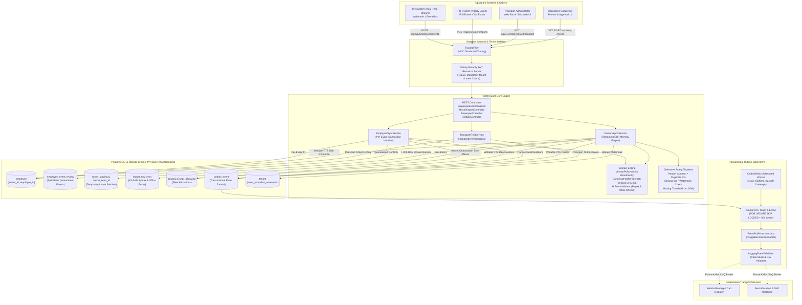
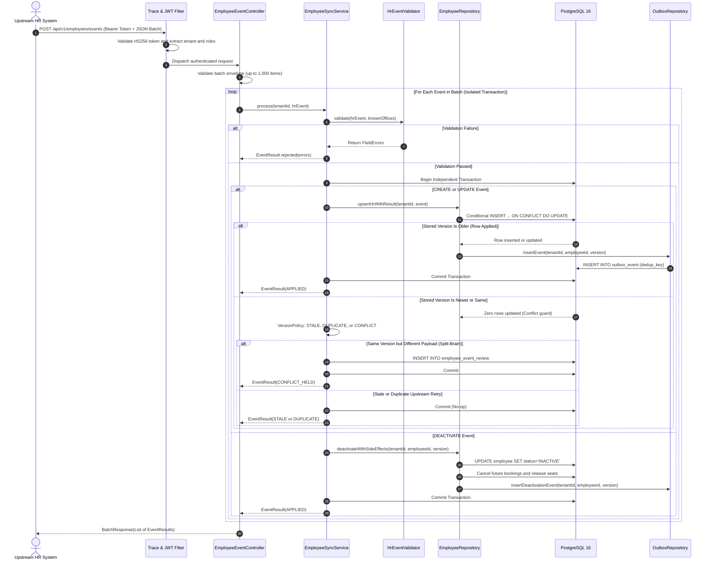
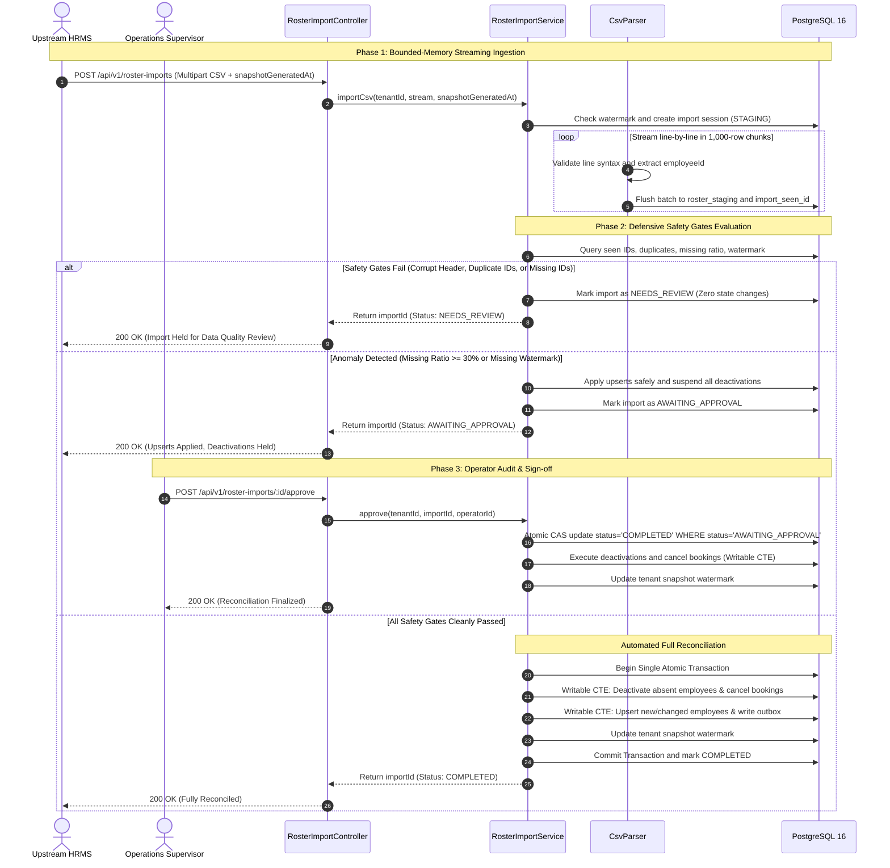
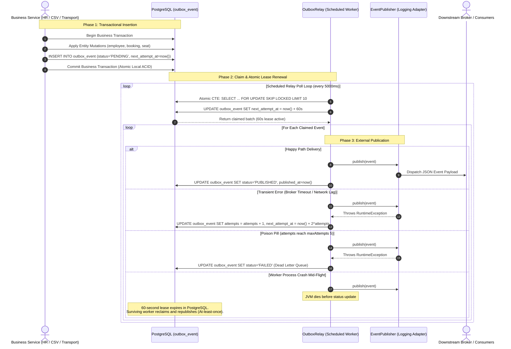
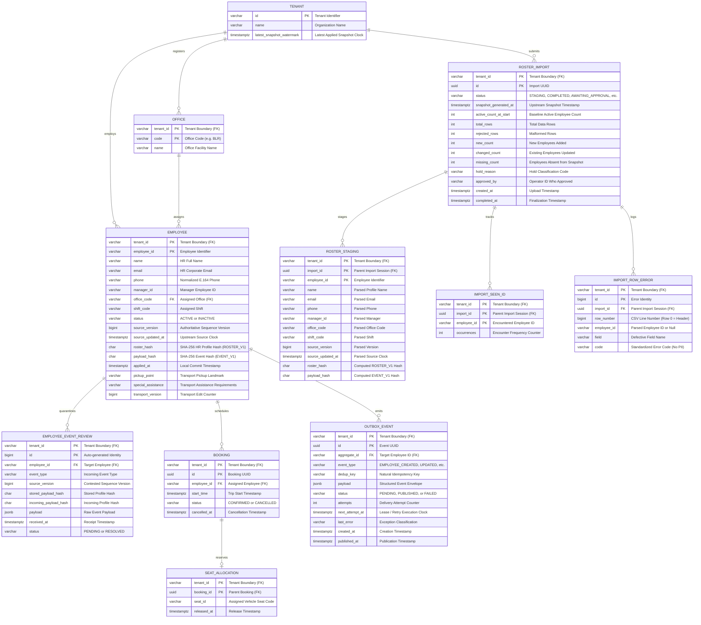

# RosterGuard — System Design & Architecture

Authoritative system architecture and design documentation for **RosterGuard**: an enterprise-grade, multi-tenant employee roster synchronisation service built with **Java 21**, **Spring Boot 3.4.5**, and **PostgreSQL 16**.

RosterGuard is engineered to bridge asynchronous real-time HR webhook streams and nightly full-roster CSV reconciliation with version-aware conflict handling, transactional side-effect execution, guarded deactivations, and at-least-once outbox delivery.

---

## 1. System Context & High-Level Architecture

RosterGuard acts as the authoritative synchronization boundary between enterprise Human Resource Management Systems (HRMS) and MoveInSync's fleet routing, transport scheduling, and employee cab allocation infrastructure.



---

## 2. Component Responsibilities & Module Interactions

The service follows a layered, hexagonal-inspired architecture with explicit separation between transport protocols, domain validation, business workflows, and physical storage.

| Component / Class | Layer | Exact Responsibilities |
|---|---|---|
| `TraceIdFilter` | Ingestion / HTTP | Extracts or generates `X-Trace-Id` HTTP header; establishes SLF4J MDC context for distributed log correlation across async tasks. |
| `SecurityConfig` & `Caller` | Security | Enforces stateless RFC 7519 JWT validation via `NimbusJwtDecoder` pinned to HS256. Validates mandatory claims (`sub`, `tenant`, `roles`). Binds tenant context immutably to the request execution thread. |
| `DevTokenController` | Security (Dev Only) | Generates test JWTs for development and verification. Annotated with `@Profile("dev")`; completely unregistered and returned as 401 in production configurations. |
| `EmployeeEventController` | Controller | Accepts real-time HR event batches (up to 1,000 items). Validates JSON envelope and converts DTOs to domain `HrEvent` records without failing valid sibling rows. |
| `RosterImportController` | Controller | Handles multipart CSV uploads (up to 32MB file / 34MB request). Delegates to import service and exposes status, paginated error, and operator approval/rejection endpoints. |
| `EmployeeController` | Controller | Exposes employee self-service lookup (self-tenant role restriction), operator keyset directory listing, and transport-admin pickup/assistance mutations. |
| `OutboxController` | Controller | Exposes operator outbox monitoring with stable composite keyset pagination over `(created_at DESC, id DESC)`. |
| `EmployeeSyncService` | Service | Orchestrates real-time event application. Enforces per-event transaction isolation, canonical hash computation, version comparison, side-effect triggers, and split-brain quarantine. |
| `RosterImportService` | Service | Streams multipart CSV bytes, invokes dynamic column parsing, controls fixed-size batch staging (1,000 rows), evaluates 5 defensive safety tripwires, and manages approval workflows. |
| `TransportFieldService` | Service | Updates transport-owned columns (`pickup_point`, `special_assistance`) and increments private `transport_version`. Strictly isolated from HR columns and source versions. |
| `VersionPolicy` | Domain | Pure domain logic evaluating incoming vs. stored version tuples. Classifies outcomes into `APPLY`, `STALE`, `DUPLICATE`, or `CONFLICT`. |
| `CanonicalHasher` | Domain | Computes deterministic SHA-256 hashes using 4-byte big-endian length prefixing over normalized UTF-8 fields, preventing delimiter collision attacks across adjacent strings. |
| `HrEventValidator` | Domain | Evaluates profile constraints: E.164 phone regex, RFC 5322 email regex, maximum field lengths, and tenant-scoped office code existence. |
| `EmployeeRepository` | Persistence | Executes atomic conditional SQL statements (`INSERT ... ON CONFLICT DO UPDATE WHERE source_version < EXCLUDED.source_version`). Names HR columns exclusively. |
| `RosterImportRepository` | Persistence | Manages batch staging via `PreparedStatement.addBatch()`, deduplicates seen IDs, records syntax errors, evaluates set-based diff queries, and runs writable CTE reconciliation. |
| `DeactivationRepository` | Persistence | Atomically cancels future confirmed bookings (`start_time > now()`) and releases allocated seats in the caller's transaction. |
| `OutboxRepository` | Persistence | Writes transactional event journal rows (`outbox_event`). Executes atomic lease acquisition via `FOR UPDATE SKIP LOCKED` combined with inline lease renewal CTE. |
| `OutboxRelay` | Relay Subsystem | Scheduled background component executing delayed poll loops (default 5,000ms). Dispatches claimed batches, updates statuses, and handles exponential retry backoff. |
| `LoggingEventPublisher` | Integration Adapter | Default implementation of `EventPublisher`. Emits structured JSON payloads to application logs. Designed to be swapped with Kafka, RabbitMQ, or AWS SNS in clustered deployments. |

---

## 3. Real-Time HR Event Ingestion

### Architectural Protocol
Real-time events arrive via `POST /api/v1/employees/events` as a `BatchRequest` containing up to 1,000 items. To prevent one malformed record from poisoning an entire batch, parsing and validation occur in two stages:
1. **Batch Parsing:** Structural or syntax errors in individual records produce an immediate `REJECTED` result at that array position; valid sibling records proceed.
2. **Per-Event Transaction Isolation:** Each valid `HrEvent` is processed inside its own isolated database transaction (`tx.execute(...)`). A runtime database failure or constraint error on employee $A$ rolls back employee $A$ only, returning `ERROR` while employee $B$ applies successfully.

### Outcome Classification Matrix
- **`APPLIED`:** Incoming `source_version > stored_version`. Row is updated or inserted; an `EMPLOYEE_CREATED` or `EMPLOYEE_UPDATED` outbox event is enqueued within the same database commit.
- **`STALE`:** Incoming `source_version < stored_version`. Event arrived out-of-order; discarded safely as a no-op.
- **`DUPLICATE`:** Incoming `source_version == stored_version` and `incoming_payload_hash == stored_payload_hash`. Upstream retry; discarded idempotently without touching database or emitting outbox events.
- **`CONFLICT_HELD`:** Incoming `source_version == stored_version` but `incoming_payload_hash != stored_payload_hash`. Upstream split-brain condition (two contradictory profiles claiming the same sequence version). Stored profile is left untouched; conflicting payload is quarantined in `employee_event_review` for operator triage.
- **`UNKNOWN_EMPLOYEE`:** Event is `DEACTIVATE`, but employee record does not exist in the tenant database.

### Ingestion Sequence Diagram



---

## 4. Nightly CSV Reconciliation Pipeline

### Bounded-Memory Streaming Architecture ($O(1)$ JVM Heap)
Enterprises with 200,000+ employees generate export CSV files exceeding 18MB–50MB. Reading the entire file into an in-memory collection (`List<CsvRow>`) risks JVM heap exhaustion and triggers severe Garbage Collection pauses. 

RosterGuard achieves strict bounded-memory execution ($O(1)$ heap utilization):
- `CsvParser` wraps the multipart input stream in a `BufferedReader` (64KB buffer), processing exactly one line at a time.
- Rows are accumulated into fixed-capacity JVM lists of `BATCH_SIZE = 1,000`.
- When a batch fills, it is flushed directly to PostgreSQL staging tables (`roster_staging`, `import_seen_id`) via JDBC batch execution (`PreparedStatement.addBatch()`).
- The in-memory lists are immediately cleared, releasing references for garbage collection.
- Peak JVM heap remains flat throughout the ingestion of hundreds of thousands of rows.

### In-Memory Batch Pre-Aggregation
PostgreSQL throws an error (`ON CONFLICT DO UPDATE command cannot affect row a second time`) if a single SQL batch statement contains duplicate primary keys. Upstream CSV exports frequently contain accidental duplicate employee IDs.
To prevent batch execution failure while maintaining streaming:
- `RosterImportRepository.recordSeenIds()` aggregates employee occurrences in an in-memory `LinkedHashMap<String, Integer>` before binding parameters, converting intra-batch duplicates into single aggregated count increments.
- `RosterImportRepository.stageBatch()` retains the first occurrence per batch via `uniqueRows.putIfAbsent(r.employeeId(), r)`. Subsequent safety gates inspect the complete database snapshot and trip defensive review holds.

### Defensive Safety Gates & Tripwires
Before any destructive change or profile overwrite is committed, the staged import is evaluated against 5 defensive tripwires:

```
[Import Uploaded]
       │
       ▼
[Stale Watermark Check] ──── (snapshotGeneratedAt <= latest_watermark) ────► [NEEDS_REVIEW: STALE_SNAPSHOT]
       │
       ▼
[Gate 0: Header Syntax] ──── (Missing/Duplicate/Unexpected Columns) ────► [NEEDS_REVIEW: INVALID_HEADER]
       │
       ▼
[Gate A: Missing ID] ─────── (Any row lacks usable employeeId) ────────► [NEEDS_REVIEW: MISSING_EMPLOYEE_ID]
       │
       ▼
[Gate B: Duplicate IDs] ──── (Any ID has occurrences > 1) ─────────────► [NEEDS_REVIEW: DUPLICATE_EMPLOYEE_ID]
       │
       ▼
[Gate C: No Watermark] ───── (snapshotGeneratedAt is NULL) ─────────────► [AWAITING_APPROVAL: NO_SNAPSHOT_WATERMARK]
       │                                                                  (Upserts Applied, Deactivations Held)
       ▼
[Gate D: Missing Ratio] ──── (Missing / Active >= Threshold) ───────────► [AWAITING_APPROVAL: MISSING_THRESHOLD_EXCEEDED]
       │                                                                  (Upserts Applied, Deactivations Held)
       ▼
[All Gates Passed] ─────────────────────────────────────────────────────► [COMPLETED: Automated Full Reconcile]
                                                                          (Upserts + Deactivations + Watermark)
```

1. **Stale Snapshot Watermark Protection:** Evaluated immediately. If `snapshotGeneratedAt <= tenant.latest_snapshot_watermark`, the file represents an outdated state that arrived late. Reconciliation halts immediately as `NEEDS_REVIEW` (`HoldReason.STALE_SNAPSHOT`).
2. **Gate 0 (Header Syntax):** Enforces RFC 4180 header contracts. Missing required columns, duplicate column names, empty headers, or unknown columns halt parsing at row 0 (`NEEDS_REVIEW`, `INVALID_HEADER`).
3. **Gate A (Missing Employee IDs):** If any row lacks a valid employee ID, the file has corrupted lines. Reconciling could erroneously mark valid employees as missing and deactivate them. Status set to `NEEDS_REVIEW` (`MISSING_EMPLOYEE_ID`).
4. **Gate B (Duplicate Employee IDs):** If `import_seen_id` contains any record with `occurrences > 1`, upstream export generated conflicting rows. Reconciliation halts as `NEEDS_REVIEW` (`DUPLICATE_EMPLOYEE_ID`). Zero updates applied.
5. **Gate C (No Watermark Provided):** If `snapshotGeneratedAt` is omitted, the snapshot timestamp is unknown. Employees absent from the snapshot cannot be safely deactivated because their profile may have been updated after the export. Upserts are applied safely; deactivations are held in `AWAITING_APPROVAL` (`NO_SNAPSHOT_WATERMARK`).
6. **Gate D (Missing Threshold Exceeded):** Compares absent employee count against active tenant count. If `missingRatio >= rosterguard.roster.missing-threshold` (default 30%), a bulk truncation or system export crash is suspected. Upserts are applied; deactivations are suspended in `AWAITING_APPROVAL` (`MISSING_THRESHOLD_EXCEEDED`).

### Automated vs. Operator-Approved Reconcile Flow



---

## 5. Transactional Outbox Lifecycle & Worker Leasing

### Dual-Write Problem Elimination
Directly publishing events to an external message broker (such as Kafka or RabbitMQ) inside a database transaction creates a dual-write distributed transaction vulnerability:
1. If the message broker publishes successfully but the database commit fails (e.g. timeout or constraint error), phantom events are broadcast downstream.
2. If the database commits but the network fails before publishing to the broker, messages are lost permanently.

RosterGuard eliminates dual-writes via the **Transactional Outbox Pattern**:
- Every applied mutation (HR API create/update/deactivate, transport update, CSV bulk create/update/deactivate) writes an event row into `outbox_event` inside the exact same PostgreSQL transaction.
- If the business mutation rolls back, the outbox event rolls back.
- An asynchronous relay worker decouples database persistence from external dispatch.

### Worker Leasing & Concurrent Safety
To allow multi-instance horizontal scaling (e.g. multiple Kubernetes pods running RosterGuard) without message duplication:
1. Workers poll using `SELECT ... FOR UPDATE SKIP LOCKED`, allowing parallel workers to claim distinct event batches without lock contention.
2. The claim statement is combined into an **atomic leasing CTE**:
   ```sql
   WITH claimed AS (
       SELECT tenant_id, id FROM outbox_event
       WHERE status = 'PENDING' AND next_attempt_at <= now()
       ORDER BY next_attempt_at LIMIT 10
       FOR UPDATE SKIP LOCKED
   )
   UPDATE outbox_event e
   SET next_attempt_at = now() + (CAST(? AS int) * interval '1 second')
   FROM claimed
   WHERE e.tenant_id = claimed.tenant_id AND e.id = claimed.id
   RETURNING ...;
   ```
3. By advancing `next_attempt_at` by 60 seconds (configurable) in the same transaction as the lock acquisition, other workers cannot re-claim the row even after the initial claim transaction commits.
4. If a worker process crashes mid-flight, the 60s lease expires naturally, and a surviving worker reclaims the event.

### Lifecycle Sequence Diagram



---

## 6. Database Schema, Entity Relationships & Indexing Strategy

### Multi-Tenant Physical Key Scoping Pattern
RosterGuard enforces multi-tenant boundary isolation at the database engine level. Every table (with the sole exception of the global `tenant` registry) defines `tenant_id VARCHAR(64)` as the first column in its primary key and foreign keys.

This structural invariant ensures that:
- Queries naturally filter via B-Tree index prefix scans on `tenant_id`.
- Foreign key constraints physically reject any attempt by tenant $A$ to reference records belonging to tenant $B$.
- Cross-tenant data leakage is structurally impossible even in the event of an application software bug.

### Entity Relationship Diagram



### Strategic Index Design
1. **`employee_active_idx` (`employee(tenant_id) WHERE status = 'ACTIVE'`):**
   - Partial B-Tree index covering only active employees.
   - Eliminates table scans during reconciliation when calculating baseline active employee counts (`active_count_at_start`) and executing anti-joins against `import_seen_id`.
2. **`booking_future_idx` (`booking(tenant_id, employee_id, start_time) WHERE status = 'CONFIRMED'`):**
   - Partial composite index index-filtering confirmed bookings in the future.
   - Allows instant row locking and cancellation during employee deactivation without scanning historical trips.
3. **`outbox_pending_idx` (`outbox_event(next_attempt_at) WHERE status = 'PENDING'`):**
   - Partial B-Tree index supporting sub-millisecond worker polling queries (`WHERE status = 'PENDING' AND next_attempt_at <= now()`).
4. **`outbox_tenant_created_idx` (`outbox_event(tenant_id, created_at DESC, id DESC)`):**
   - Composite keyset pagination index supporting deterministic, stable cursor traversal for operator outbox audit APIs.

---

## 7. Transaction Boundaries & Consistency Guarantees

RosterGuard maintains strict consistency boundaries across real-time mutations, nightly batch operations, and event publishing.

| Workflow | Transaction Boundary | Database Isolation | Atomic Guarantees & Failure Handling |
|---|---|---|---|
| **HR Real-Time Ingestion** | Per-event transaction via `TransactionTemplate.execute()` | Read Committed (PostgreSQL Default) | Upsert, outbox insert, or deactivation side effects commit atomically. An unhandled exception or constraint failure on one event rolls back that event completely, returning `ERROR` without affecting sibling events in the batch. |
| **Transport Updates** | Method-level `@Transactional` on `TransportFieldService.update()` | Read Committed | Employee transport columns update and outbox event insert commit atomically. If outbox insertion fails, transport update rolls back. |
| **CSV Staging** | Multi-batch streaming; separate transaction per 1,000-row batch | Read Committed | Each 1,000-row batch commits independently to staging tables. A network drop during upload leaves the import record in `FAILED` status; staging rows are cleaned up automatically via foreign key cascade upon deletion. |
| **CSV Automated Reconciliation** | Single atomic transaction in `RosterImportService.processImport()` | Read Committed | Set-based writable CTEs execute: 1) absent employee deactivations, 2) future booking cancellations, 3) seat releases, 4) outbox deactivation events, 5) new/changed employee upserts, 6) outbox upsert events, and 7) tenant snapshot watermark update in **one single commit**. If any stage fails, the entire reconciliation rolls back; zero employees are deactivated. |
| **CSV Operator Approval** | Single atomic transaction in `RosterImportService.approve()` | Read Committed | Status transition from `AWAITING_APPROVAL` to `COMPLETED` is guarded by an atomic CAS query (`WHERE status = 'AWAITING_APPROVAL'`). Exactly one operator wins concurrent races; deactivations and watermark updates execute within the winning transaction. |
| **Outbox Claim & Lease** | Short independent transaction in `OutboxRelay.relay()` | Read Committed | Claims up to 10 rows via `FOR UPDATE SKIP LOCKED` and advances `next_attempt_at` by 60 seconds atomically before committing. Row locks are released immediately; the 60s lease prevents other workers from claiming the events. |
| **Outbox Publication** | Per-event status transaction in `OutboxRelay.processOne()` | Read Committed | The network call to `EventPublisher.publish()` executes **outside** database transactions. Upon return, a short transaction updates the row to `PUBLISHED` or updates `attempts`/`next_attempt_at`. |

### Database Atomicity vs. At-Least-Once Delivery
- **Inside PostgreSQL:** System state transitions are 100% ACID atomic. An employee cannot be deactivated without their bookings being cancelled and their outbox event recorded.
- **Across the Network Boundary:** Delivery from the transactional outbox to external consumers guarantees **at-least-once delivery**. If a relay worker publishes an event to an external broker and crashes before committing the `status = 'PUBLISHED'` update, the 60-second lease will expire and a surviving worker will re-deliver the event. Downstream subscribers must ensure idempotency using the event's `id` (UUID) or `dedup_key`.

---

## 8. Architectural Decisions, Alternatives & Trade-Offs

### D1: Unified Monotonic Source Versioning
- **Decision:** All state updates (whether originating from real-time HR webhook events or nightly CSV snapshot rows) are governed by a single monotonically increasing integer `source_version` provided by the authoritative HR system.
- **Alternatives Considered:**
  - *Server-side Lamport clocks or auto-incrementing timestamps:* Rejected because network lag and server clock drift cause out-of-order writes to overwrite newer state.
  - *Last-Write-Wins (LWW) based on source timestamp:* Rejected because sub-millisecond updates from high-velocity HR batch tools can share identical timestamps.
- **Trade-offs:** Requires the upstream HRMS to maintain and emit sequential version numbers per employee.

### D2: Conditional Atomic SQL Upsert Without Distributed Locks
- **Decision:** Enforce version monotonicity in a single atomic SQL statement:
  ```sql
  INSERT INTO employee (...) VALUES (...)
  ON CONFLICT (tenant_id, employee_id) DO UPDATE SET ...
  WHERE employee.source_version < EXCLUDED.source_version;
  ```
- **Alternatives Considered:**
  - *Distributed Redis Locks (`Redisson` / `RLock`):* Rejected due to network round-trip overhead, lock expiration tuning hazards, and split-brain risks under network partitions.
  - *Optimistic Locking with `@Version` in JPA/Hibernate:* Rejected because it requires an initial SELECT, generating retry-loop churn and high abort rates under concurrent updates to the same employee.
- **Trade-offs:** Pushes concurrency control entirely to PostgreSQL row-level locks, achieving higher throughput with zero distributed infrastructure dependencies.

### D3: Set-Based Writable CTEs for Bulk Reconciliation
- **Decision:** Execute nightly CSV reconciliation set-based inside PostgreSQL using writable Common Table Expressions (CTEs), linking employee deactivations, booking cancellations, seat releases, and outbox event insertions in a single query.
- **Alternatives Considered:**
  - *Application-level iteration:* Streaming diff rows into Java memory, loading individual entities, and executing updates in a loop. Rejected due to $O(N)$ network round-trips and massive latency (hours for 200,000 rows).
- **Trade-offs:** Business side-effects reside in optimized SQL statements rather than Spring service code, requiring thorough integration test coverage (`DeactivationTransactionRollbackIT`).

### D4: Strict Structural Separation of Field Ownership
- **Decision:** Field ownership is enforced structurally at the schema and SQL level:
  - HR SQL statements name only HR profile columns.
  - Transport SQL statements name only transport columns.
- **Alternatives Considered:**
  - *Dynamic column masks / Hibernate dynamic update:* Rejected because an omitted field in a DTO could inadvertently be overwritten with nulls.
- **Trade-offs:** Requires distinct repository methods and DTO contracts for HR integration vs. Transport administration.

### D5: Defensive Multi-Stage Safety Gates & Watermark Protection
- **Decision:** Nightly CSV imports never deactivate employees if data quality is suspect. Imports halt in `NEEDS_REVIEW` (header errors, duplicate IDs, missing IDs, stale watermarks) or `AWAITING_APPROVAL` (missing watermark, missing ratio $\ge$ 30%).
- **Alternatives Considered:**
  - *Blind automated deactivation:* Immediately deactivating all employees absent from the CSV. Rejected because a corrupted or truncated export file would trigger catastrophic bulk deactivations of thousands of active employees.
- **Trade-offs:** Requires human supervisor intervention via the approval API when anomalous batches or legitimate corporate restructuring events occur.

### D6: Physical Multi-Tenant Scoping (Tenant-Leading Composite Keys)
- **Decision:** Every table primary key and foreign key is prefixed with `tenant_id`.
- **Alternatives Considered:**
  - *Schema-per-tenant:* Creating a PostgreSQL schema per client. Rejected due to schema migration complexity (running Flyway over hundreds of schemas) and connection pool overhead.
  - *Logical application-level checks (`WHERE tenant_id = ?` in code alone):* Rejected because a missed predicate in any query could cause disastrous cross-tenant data leakage.
- **Trade-offs:** Primary keys and foreign keys are composite, requiring slightly larger index storage in PostgreSQL.

### D7: Transactional Outbox with SKIP LOCKED & Atomic CTE Lease
- **Decision:** Mutations transactionally write outbox events. An asynchronous relay claims batches using `FOR UPDATE SKIP LOCKED` and leases them for 60 seconds in a single atomic CTE.
- **Alternatives Considered:**
  - *Dual-writing directly to Kafka/MQ:* Rejected due to the dual-write consistency hazard.
  - *Periodic table polling without lease renewal:* Suffers from concurrent worker race conditions if worker A's network call takes longer than worker B's polling interval.
- **Trade-offs:** Introduces polling load on PostgreSQL and requires downstream subscribers to implement idempotent message deduplication.

### D8: In-Memory Batch Pre-Aggregation
- **Decision:** Pre-aggregate employee occurrences and deduplicate staging rows in memory before issuing JDBC batch statements.
- **Alternatives Considered:**
  - *Raw batch execution:* Throws PostgreSQL error `ON CONFLICT DO UPDATE command cannot affect row a second time` if duplicate IDs appear in the same batch.
- **Trade-offs:** In-memory batch buffers must maintain small bounded maps (1,000 entries), slightly increasing CPU overhead during streaming parse.

### D9: Length-Prefixed SHA-256 Canonical Hashing
- **Decision:** Hash canonical profile strings by prepending each field with a 4-byte big-endian length prefix.
- **Alternatives Considered:**
  - *Delimiter-separated strings (e.g. `col1 + "|" + col2`):* Vulnerable to injection attacks and boundary collision ambiguities when field values contain the delimiter character.
- **Trade-offs:** Hashing requires byte buffer manipulation rather than simple string concatenation.

### D10: Pluggable Logging Publisher Adapter
- **Decision:** Deliver outbox events via `LoggingEventPublisher` by default in the case-study implementation.
- **Alternatives Considered:**
  - *Mandating local Kafka / RabbitMQ containers:* Increases setup complexity and test execution overhead for evaluators.
- **Trade-offs:** Demonstrates the complete outbox lifecycle and crash recovery without requiring evaluators to configure external message brokers.
